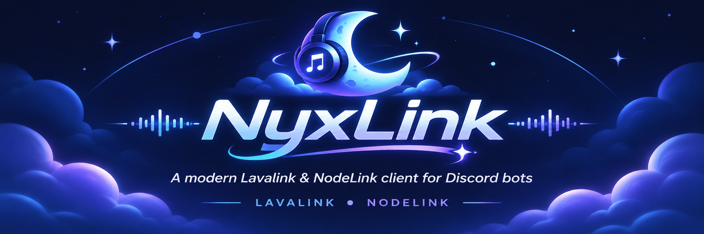

# NyxLink

Cliente de audio para bots de Discord derivado de [Moonlink.js](https://github.com/Ecliptia/moonlink.js). El desarrollo parte de Moonlink `dev` 5.3.0-dev.2 y conserva su API pública cuando es posible.

Los backends objetivo son **Lavalink v4 y NodeLink**. Las pruebas locales cubren REST, WebSocket y reanudación de sesiones; el audio audible y la voz real de Discord siguen pendientes; consulta el [estado de desarrollo](docs/development.md) y el [plan de trabajo](tasks/todo.md).

## Desarrollo

Requiere Node.js 22.12+ o 24 y pnpm 10.34.5.

```sh
git clone --branch feat/nyxlink-track-storage https://github.com/melodiabl/NyxLink.git
cd NyxLink
corepack pnpm install --frozen-lockfile
pnpm run typecheck
pnpm test
pnpm run test:types
pnpm run pack:check
```

`pnpm test` compila y ejecuta pruebas automáticas sin tokens ni conexiones a Discord. `pnpm run test:bot` ejecuta el bot manual y requiere su propia configuración de pruebas.

## Estado de distribución

Esta rama es de desarrollo y la publicación está desactivada. El nombre npm heredado `moonlink.js` permanece como metadato histórico hasta elegir la identidad final de distribución; no identifica un paquete NyxLink publicado. No uses las estadísticas, versiones o instrucciones npm de Moonlink como si fueran de NyxLink.

## Logs

Los eventos `debug` heredados siguen disponibles. Sus mensajes técnicos pueden incluir contraseñas de nodos y tokens de voz: el responsable del bot controla el acceso a la consola y a sus archivos. No se deben reenviar automáticamente a navegadores, canales de Discord ni servicios externos.

El [logger Consola Combinado](docs/logging.md) es opcional: incluye banner ASCII y paneles de estado/failover con información real. Consulta también los [cambios de reproducción, recuperación y volumen](docs/playback.md) y el [changelog](CHANGELOG.md).

## Nodos y compatibilidad local

La segunda entrega incorpora selección/salud de nodos, failover limitado por intentos y adaptadores de capacidades. La [matriz de compatibilidad](docs/backend-compatibility.md) distingue las pruebas reales de protocolo de la reproducción audible en Discord.

En Linux con Podman o Docker puedes repetir el laboratorio local sin tokens de Discord:

```sh
pnpm run test:backends
# Con Docker:
NYXLINK_CONTAINER_ENGINE=docker pnpm run test:backends
```

El laboratorio descarga imágenes oficiales fijadas por digest, inicia servidores en localhost y elimina sus propios contenedores al finalizar. El resto del plan continúa en [tasks/todo.md](tasks/todo.md).

## Pistas, almacenamiento y voz

La [tercera entrega](docs/tracks-storage-voice.md) añade resolución de pistas en el backend de destino, snapshots con metadatos, un contrato StorageAdapter y coordinación del gateway de voz con protección frente a respuestas obsoletas. Las firmas heredadas se conservan y las pruebas no conectan bots de Discord.

## Licencia y origen

Derivado de Moonlink.js, de **1Lucas1.apk y sus colaboradores**. Se conservan los avisos originales y la licencia [Open Software License 3.0](LICENSE). Los cambios de NyxLink no implican respaldo del proyecto original.
